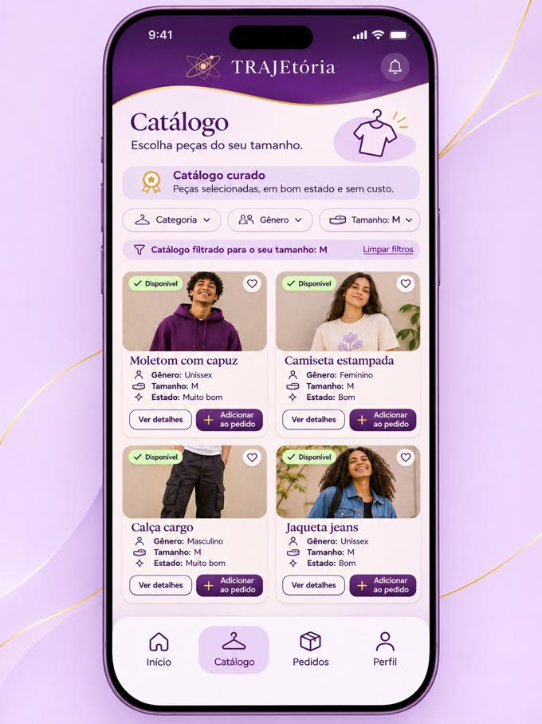
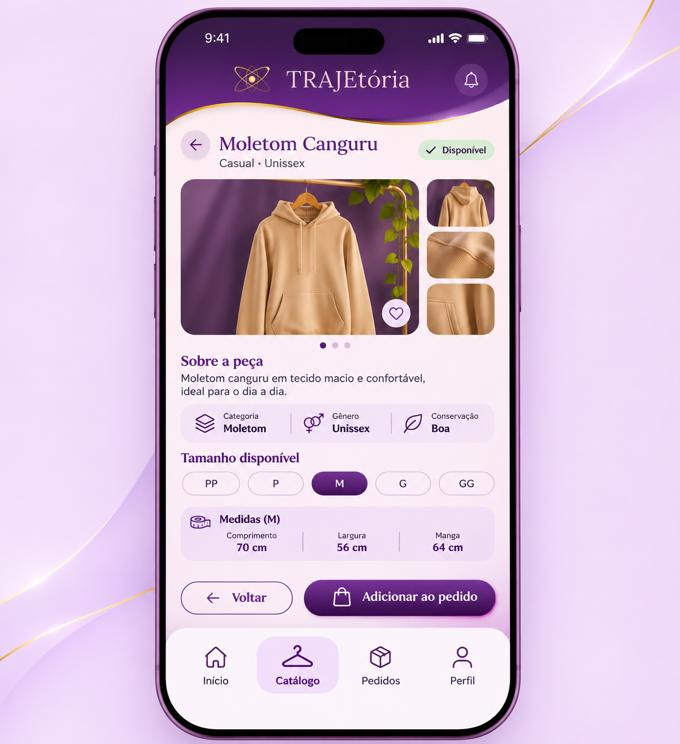
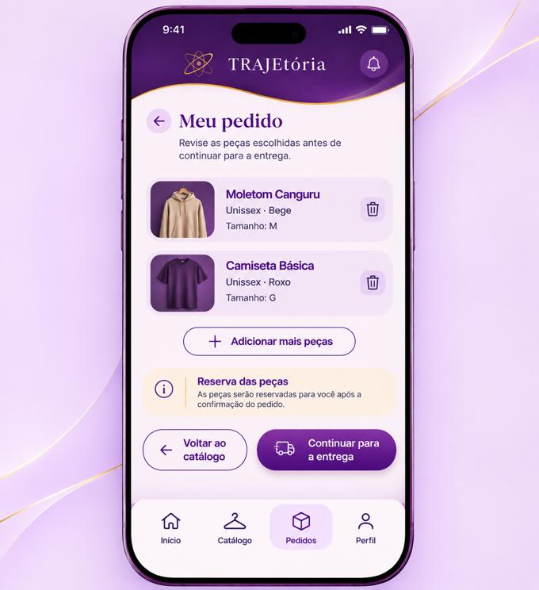
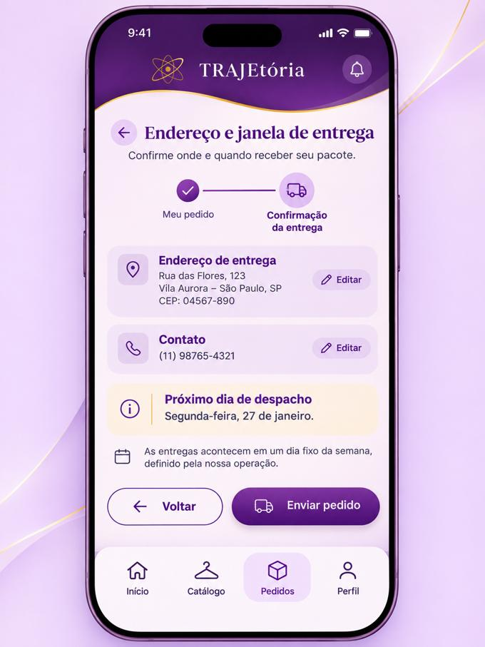
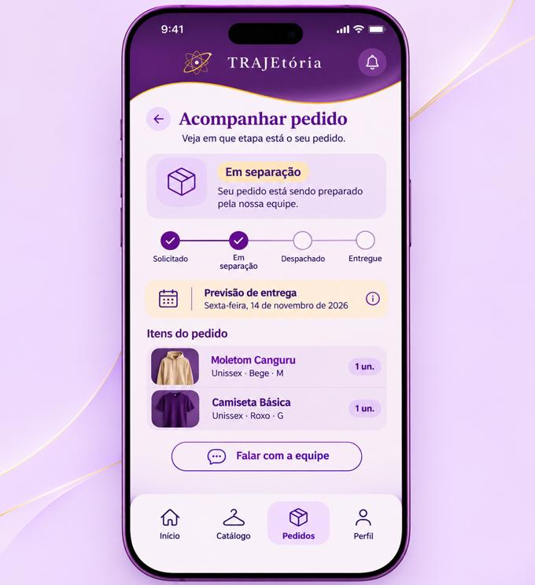
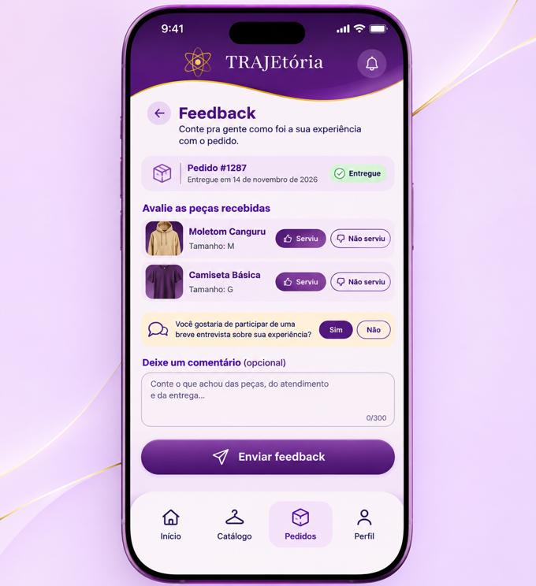
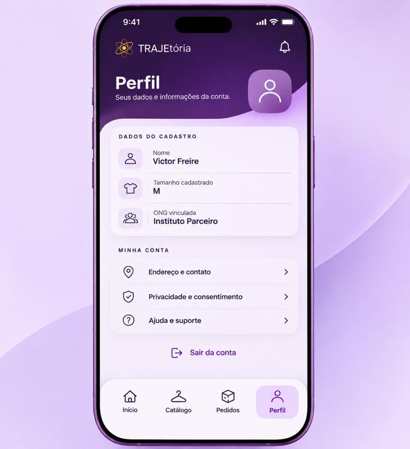

# TRAJEtória - CitizenTech | Mobile Development & IoT

## Ficha da CitizenTech

| Item | Descrição |
|---|---|
| Nome da solução | TRAJEtória |
| Localização | São Caetano do Sul / Região do ABC — SP |
| Cidadão beneficiado | Jovens em situação de vulnerabilidade social, de 16 a 24 anos, indicados por ONGs parceiras, que precisam de roupas sociais adequadas para entrevistas de emprego, processos seletivos e primeiros dias de trabalho. |
| Problema | Jovens em vulnerabilidade não têm roupas sociais adequadas para entrevistas e oportunidades de trabalho, enquanto doações de roupas chegam às ONGs de forma desorganizada, sem rastreio, sem curadoria de tamanho e sem garantia de que cheguem a quem realmente precisa. |
| Como a solução resolve | A TRAJEtória é um aplicativo mobile que organiza a jornada do jovem: acesso e consentimento; catálogo curado com filtros de categoria, gênero e tamanho; detalhe da peça; seleção de até 5 peças; confirmação de endereço e contato; envio do pedido com reserva das peças; acompanhamento dos status; e feedback pós-entrega informando quais peças serviram. Cadastro/validação de jovens, gestão do acervo e logística ficam nos módulos ONG, galpão e administração, previstos para versões futuras. |
| Partes envolvidas | ONGs parceiras (cadastro e validação dos jovens), operação da TRAJEtória (gestão do acervo e logística de entrega), jovens beneficiados (solicitação e feedback) e administração da plataforma. |
| Repositório | https://github.com/doup601/TRAJEtoria-mobile |
| Indicador de impacto | Percentual de peças entregues que "serviram" segundo o feedback dos jovens (peças reprovadas voltam ao acervo) e número de jovens atendidos por mês. |
| ODS relacionados | ODS 10 — Redução das Desigualdades (acesso a vestuário adequado para ingresso no mercado de trabalho); ODS 8 — Trabalho Decente e Crescimento Econômico (apoio à empregabilidade de jovens); ODS 12 — Consumo e Produção Responsáveis (reuso de roupas por meio da doação organizada). |

## Equipe

| Integrante | RM |
|---|---|
| Pedro Gaspar Fernandes Ferrari | 554887 |
| Enrico Ricarte Rodrigues | 558571 |
| Victor Freire | 556191 |

**Turma:** 3ESPH  
**Data:** novembro de 2026

## Escopo desta entrega

Primeira versão em **Expo + React Native + TypeScript + Expo Router + SQLite**, composta por **11 telas**: T01 Acesso, T02 Consentimento, T03 Início, T04 Catálogo, T05 Detalhe, T06 Meu pedido, T07 Endereço/entrega, T08 Acompanhar pedido, T09 Feedback, TP01 Perfil do jovem e Histórico de pedidos.

É a **primeira etapa de um produto maior**: a modelagem original possui 23 telas; a versão acadêmica começa pelo jovem. Futuramente entram ONG (T10-T11), galpão (T12-T19), administração (T20-T22) e doação (T23). A TP01 e o histórico de pedidos são telas complementares à numeração original.

**Esta versão é uma demonstração acadêmica, não um sistema de autenticação/entrega pronto para operação com pessoas reais.**

## Como executar no VS Code

Instale Node.js **22.13 ou superior** e Expo Go no smartphone (iOS ou Android). Esta versão usa o **Expo SDK 57** e foi testada com **Expo Go 57** em dispositivo Android e no emulador Android Studio. Use uma versão do Expo Go compatível com o SDK 57; no Android, a instalação pode ser feita pelo link https://expo.dev/go?sdkVersion=57&platform=android&device=true. Não é necessário atualizar o projeto para o SDK 58.

```bash
# 1) Clone o repositório e abra esta pasta no VS Code
# 2) No terminal, nesta mesma pasta:
npm install

# 3) Verifique eventuais alinhamentos de versões nativas:
npx expo install --check

# 4) Inicie o Expo:
npx expo start
```

Use o QR Code mostrado pelo Expo para abrir no Expo Go. Se o dispositivo não encontrar o servidor, deixe celular e computador na mesma rede ou experimente `npx expo start --tunnel`.

A aplicação utiliza o plugin `expo-sqlite`, que persiste os dados localmente no dispositivo. Não é necessário servidor externo nem configurar `.env`.

### Credenciais fictícias

- **Identificação:** `lucas.demo`
- **Senha:** `trajetoria123`

O login consulta a conta de exemplo armazenada no SQLite. A senha de demonstração é comparada com hash SHA-256 apenas para demonstrar fluxo de login. Não constitui autenticação segura para uso real. **Não utilize credenciais pessoais reais.**

## Como testar a jornada

1. Entre com a conta fictícia e aceite o termo na T02. A data e a versão são registradas no SQLite; em novo login o termo não aparece novamente, salvo se a versão for alterada.
2. Na T03, escolha o catálogo. Na T04, alterne os filtros de categoria/gênero/tamanho. As peças disponíveis são obtidas de uma camada de serviço assíncrona, com carregamento e tratamento de erro/vazio.
3. Abra uma peça na T05 e adicione-a à seleção. A T06 permite remover e escolher até **cinco** peças.
4. Na T07, confira os dados de endereço. Se desejar, use **Editar**. O dia fixo de **despacho é quinta-feira**; a data de entrega é independente e pode estar indefinida.
5. Envie o pedido. O app valida a disponibilidade novamente e grava pedido, itens, histórico, endereço confirmado e reserva das peças em uma transação SQLite. Novos pedidos começam em **Solicitado**, sem avanço artificial de status.
6. A T08 lista pedidos existentes e estados de demonstração. Há três pedidos fictícios: **Em separação**, **Despachado** e **Entregue**. Os estados não são atualizados automaticamente; no produto real, viriam da operação do galpão.
7. Escolha o pedido demonstrativo **Entregue** para abrir a T09; avalie se cada peça serviu, informe se **já participou** de entrevista e envie comentário opcional. As respostas ficam registradas no banco. O item “Não serviu” ficará disponível para o futuro fluxo de retorno ao estoque (T19).
8. Na TP01, consulte os dados e encerre a sessão. Os dados do perfil são somente leitura. A correção de endereço está disponível exclusivamente na T07.

**Estados de consumo de dados:** T04 possui carregamento assíncrono, estado vazio ao filtrar sem resultados, recuperação de erro e, no modo de desenvolvimento, um link discreto para simular uma falha.

## Prints das telas principais

As imagens de `docs/designs-aprovados` são as referências visuais aprovadas e são usadas neste README como prints das telas principais. O aplicativo implementado segue essas telas; pequenas diferenças de dimensionamento podem ocorrer entre aparelhos.

| T01 — Acesso | T02 — Consentimento | T03 — Início |
|---|---|---|
|  |  |  |

| T04 — Catálogo | T05 — Detalhe | T06 — Meu pedido |
|---|---|---|
|  |  |  |

| T07 — Entrega | T08 — Acompanhamento | T09 — Feedback |
|---|---|---|
|  |  |  |

| TP01 — Perfil |
|---|
|  |

## Vídeo de demonstração

**Link do vídeo (YouTube, não listado):** _[https://youtu.be/n9vDEEUXb7o?is=EcYI2yHvfLEaeVJg]_

## Origem dos dados

A modelagem foi adaptada das seções **7.1, 7.2, 7.3 e Figura 4** da documentação funcional e técnica original do TRAJEtória, de 09/11/2026. As tabelas `usuarios`, `ongs`, `jovens`, `pecas`, `pedido_itens`, `pedidos` e `feedbacks` refletem o domínio; estruturas auxiliares registram fotos, seleção temporária, consentimento, histórico e avaliações por peça.

Todos os **15 itens**, a ONG, o jovem e os **3 pedidos iniciais** são **fictícios**, provenientes de `assets/mock/seed.json`. Fotos de roupas foram recortadas dos mockups gerados para o próprio projeto; outras imagens são ilustrações locais. Não representam estoque real. `src/services/catalogService.ts` simula uma API com atraso e pode ser trocado por requisições `fetch` ou Axios no futuro.

A carga inicial (`src/database/seeds/initialData.ts`) roda **somente na instalação inicial**, preservando o que o usuário fizer nos acessos seguintes.

## Banco de dados escolhido e justificativa

O **SQLite (expo-sqlite)** foi escolhido porque o enunciado admite persistência local, ele funciona sem conexão e permite demonstrar relacionamentos, histórico, feedback e reserva transacional usando apenas ferramentas gratuitas. SQL e seeds estão em `database/schema.sql` e `assets/mock/seed.json`. A inicialização com migração versionada está em `src/database/connection.ts`.

Tabelas (12): `usuarios`, `ongs`, `jovens`, `pecas`, `peca_fotos`, `consentimentos`, `selecao_itens`, `pedidos`, `pedido_itens`, `historico_pedidos`, `feedbacks`, `feedback_itens`.

**Limitações:** dados são locais a cada instalação; ainda não há sincronização entre dispositivos, controle de estoque centralizado, rastreio GPS, validação de raio geográfico ou autenticação real. Os módulos de galpão/ONG/admin e as regras legais finais exigirão API e servidor.

## Estrutura de pastas

```text
app/
  index.tsx                   T01 - acesso
  consentimento.tsx           T02
  (jovem)/
    inicio.tsx                T03
    catalogo.tsx              T04
    detalhe/[id].tsx          T05
    meu-pedido.tsx            T06
    entrega.tsx               T07
    acompanhar.tsx            T08
    feedback.tsx              T09
    perfil.tsx                TP01
    historico-pedidos.tsx     histórico complementar
src/
  components/Design.tsx       cabeçalho, nav inferior, botões, cards, estados
  constants/theme.ts         paleta, tipografia, espaçamentos e regras
  database/                  SQLite, migração, seed, repositórios
  services/catalogService.ts mock assíncrono
  context/AuthContext.tsx    sessão fictícia
  types/ utils/               modelos e utilitários
database/schema.sql          SQL para revisão/testes
docs/designs-aprovados/       10 imagens de referência usadas como prints
assets/                      fotos demonstrativas e mock JSON
tests/                       testes de integridade SQL
```

## Identidade visual e acessibilidade

Identidade **Goddess Tech / TRAJEtória**: violeta profundo `#5B3B7E`, violeta noite `#2E1B3D`, lavanda `#CDB8E6`, dourado `#C9A15A`, marfim `#FBF8F4`. Fontes: **Cormorant Garamond** para títulos, **Jost** para interface. Os tokens vivem em `src/constants/theme.ts`; a barra inferior e o cabeçalho são reutilizados nas páginas.

Botões e seleções possuem rótulos e estados de acessibilidade, mensagens de erro usam texto direto, e há contraste entre texto escuro e fundo claro. O aplicativo foi testado em dispositivo real e emulador Android; recomenda-se uma rodada final com TalkBack/VoiceOver.

## Validação e testes

```bash
npm run check          # tsc --noEmit (depois de npm install)
python tests/test_schema.py
npm run test:repositories
```

Os testes locais SQL validam tabelas, relacionamentos e constraints. O aplicativo foi testado em Expo Go 57 em dispositivo Android e no emulador Android Studio. O repositório não inclui `node_modules`, APK nem vídeo; o vídeo de demonstração é externo, no YouTube.

## Referências técnicas

- https://docs.expo.dev/router/introduction/
- https://docs.expo.dev/versions/latest/sdk/sqlite/
- https://docs.expo.dev/more/create-expo/

## Notas de versão

> **Versão de manutenção v1.0.1:** dependências React DOM, Web, Reanimated e Worklets fixadas para Expo SDK 57. Veja `CORRECAO_DEPENDENCIAS.md` se já tentou instalar a versão anterior.

**Uso de dados reais:** não inclua chaves de API, senhas de produção ou dados pessoais reais. Se integrar serviços futuramente, configure `.env` e mantenha-o no `.gitignore`.
